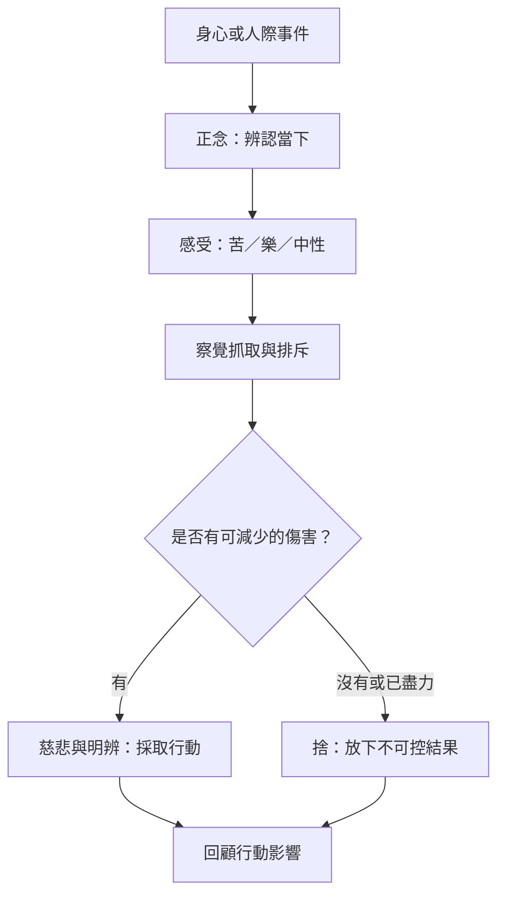

平等心可以在靜坐、身體掃描、走路與人際衝突中觀察。共通流程是：辨認經驗與感受調性、觀察追逐或排斥、分辨可行動與不可控部分，再作出不由仇恨或貪著支配的回應。

核心概念：[[受蘊]]、[[捨受]]、[[正念]]、[[無常]]、[[八世間法]]、[[精進]]。

## 思與行
* 從 [[用三個問題把平等心轉化為可實踐的回應能力]] 開始，搭配 [[以七日八世間法日記觀察自己被哪些境遇牽動]]。

## 參考
* [[禪修教師把平等心描述為如實觀察而非控制經驗]]
* [[用三個問題把平等心轉化為可實踐的回應能力]]
