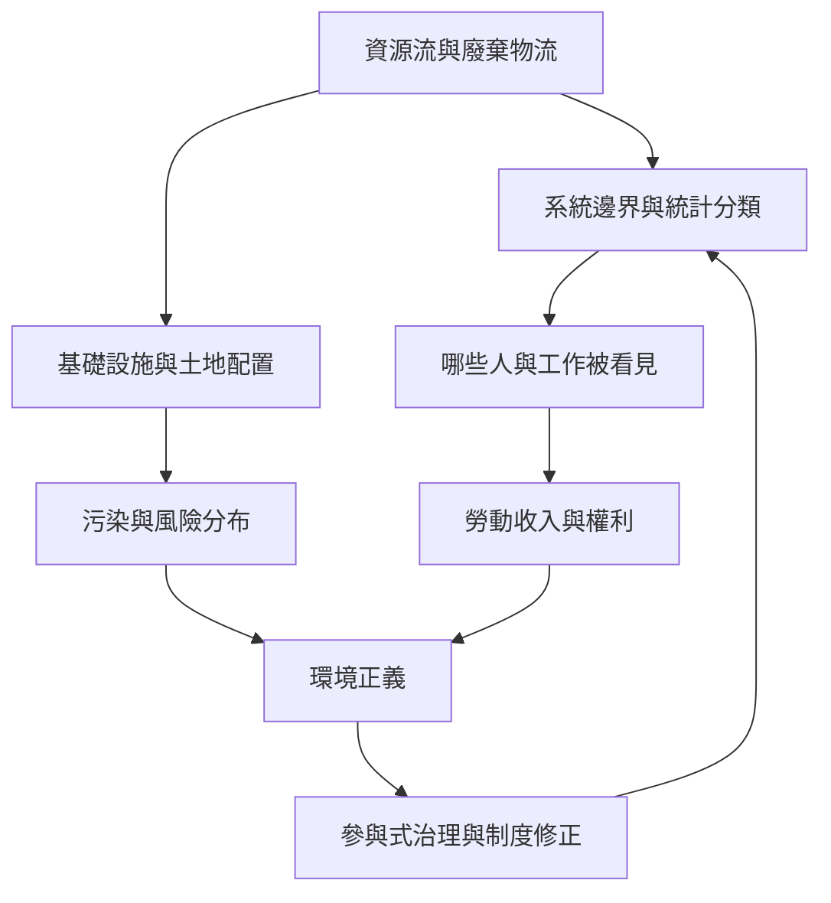

物質流不是中性的箭頭。每一個輸入、轉化、運輸與排放節點，都涉及土地控制、工作條件、所有權、決策權與風險分配。若城市代謝研究不追問「誰被算進去、誰被排除、誰受益、誰受害」，就可能讓不平等在技術圖表中消失。

概念連結：[[都市政治生態學]]、[[環境正義]]、[[非正式回收勞動]]、[[社會代謝]]、[[代謝裂縫]]。

案例入口：[[墨西哥市與聖地牙哥的廢棄物流顯示系統邊界本身具有政治性]]、[[約翰尼斯堡的非正式回收者是城市循環不可忽略的勞動基礎]]、[[臺北的氮流分析揭示污水治理與農業養分之間的斷點]]。
