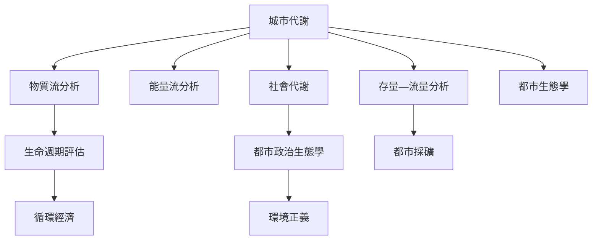

城市代謝研究連接物質與能量計量、社會代謝、都市生態學與都市政治生態學。理解此領域時，先區分研究對象（流量、存量、排放與生態關係）與研究方法（物質流、能量分析、生命週期評估、歷史比較、參與式研究）。城市本身不是封閉有機體，邊界必須隨研究問題而界定。

概念連結：[[城市代謝概念]]、[[物質流分析]]、[[能量流分析]]、[[存量—流量分析]]、[[社會代謝]]、[[都市政治生態學]]、[[都市生態學]]、[[城市生態系]]、[[生命週期評估]]、[[循環經濟]]、[[環境正義]]。

閱讀脈絡：[[城市代謝讓城市的物質能源交換成為可分析的公共問題]] → [[城市代謝的能量流與物質流是互補而非互斥的分析路徑]] → [[城市代謝的生物體隱喻不能取代城市生態系的複雜分析]]。
