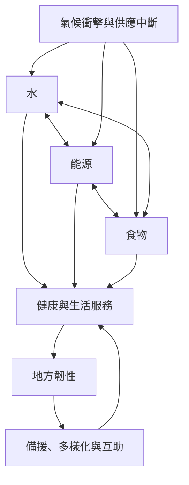

水、能源與食物不是獨立部門。抽水、淨水、冷藏、運輸、農業生產與污水處理都涉及能源；能源系統也依賴水、土地與材料。韌性因此需要多元供應、需求管理、地方維修與公平可近性。

概念連結：[[水—能源—食物關聯]]、[[能量流分析]]、[[城市生態系]]、[[都市生態學]]、[[環境正義]]。

案例入口：[[開普敦的水代謝顯示乾旱治理必須同步評估水與能源]]、[[臺北的氮流分析揭示污水治理與農業養分之間的斷點]]、[[臺北廚餘再利用的環境效益取決於轉化技術與系統條件]]。
