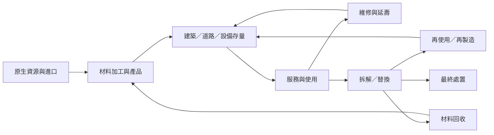

這張圖整理資源從進入城市、形成建成環境存量、提供服務、維修替換，到最終成為再利用材料或廢棄物的生命歷程。關鍵不是只把末端廢棄物回收，而是以存量資料預測未來材料供給，優先延長產品與建物壽命。

概念連結：[[存量—流量分析]]、[[物質流分析]]、[[都市採礦]]、[[工業生態學]]、[[循環經濟]]、[[生命週期評估]]。

案例入口：[[臺北都會區建材代謝受到經濟活動與土地政策共同驅動]]、[[中國城市的材料流與存量呈現不同尺度的增長型態]]、[[城市代謝比較必須同時觀察流量與累積存量]]。
