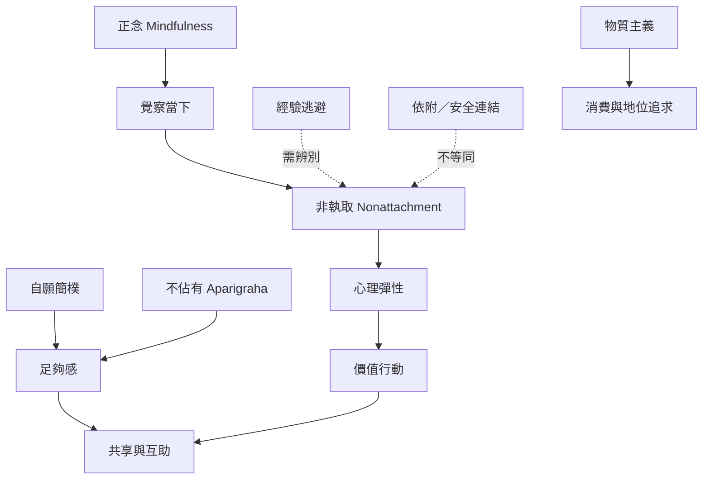

這張地圖把傳統離欲的問題，接到當代心理學與生活選擇：正念提供覺察，非執取改變與經驗的關係，心理彈性支持價值行動；經驗逃避則是需要分辨的近似混淆概念。物質主義與自願簡樸則把問題延伸到消費與社會福祉。

概念互鏈：[[term/Nonattachment|非執取]]、[[term/Attachment_theory|依附理論]]、[[term/Mindfulness|正念]]、[[term/Psychological_flexibility|心理彈性]]、[[term/Experiential_avoidance|經驗逃避]]、[[term/Values_based_action|價值行動]]、[[term/Materialism|物質主義]]、[[term/Voluntary_simplicity|自願簡樸]]、[[term/Enoughness|足夠感]]、[[term/Mutual_aid|互助]]。

閱讀入口：[[data/非執取量表把佛教的心智鬆綁轉化為可研究的心理構念]]、[[data/統合分析發現非執取與幸福感相關但尚不能證明因果]]、[[data/2026年非執取回顧把不受象徵性獎賞牽引連到價值行動]]、[[note/非執取與經驗逃避的差別在於是否願意接觸當下]]、[[note/簡樸有益的關鍵是自願和價值一致而非匱乏本身]]。

全書導讀：[[Vairagya|Vairāgya 導讀]]。
