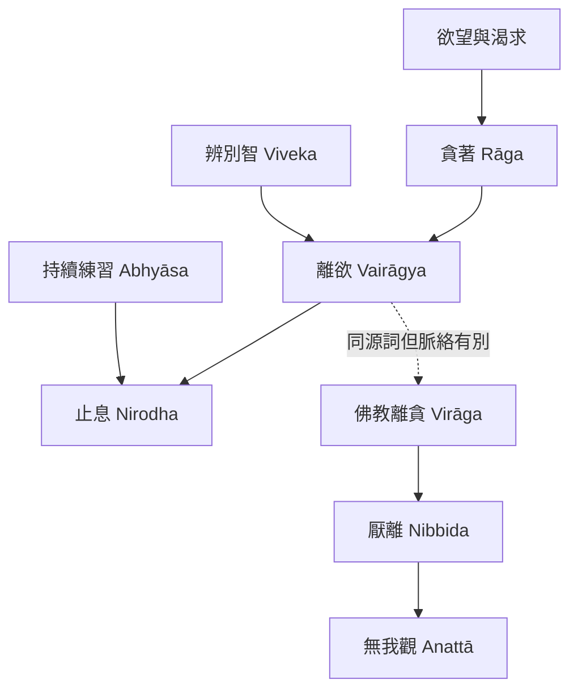

這張概念地圖聚焦印度瑜伽思想內部的修習關係：辨別、持續練習與離欲如何共同指向心識活動的止息。它也標出與佛教離欲語彙的比較入口，但不把兩套哲學的自我觀視為相同。

概念互鏈：[[term/Vairagya|Vairāgya]]、[[term/Abhyasa|Abhyāsa]]、[[term/Viveka|Viveka]]、[[term/Nirodha|Nirodha]]、[[term/Raga|Rāga]]、[[term/Dvesha|Dveṣa]]、[[term/Viraga|Virāga]]、[[term/Nibbida|Nibbida]]、[[term/Desire|欲望]]。

閱讀入口：[[data/《瑜伽經》一點十二至十六把離欲與持續練習視為雙軌修習]]、[[data/學術重讀指出瑜伽經的離欲包含反思而不只是壓抑欲望]]、[[note/離欲必須與持續練習互相校正而不是互相取代]]。

全書導讀：[[Vairagya|Vairāgya 導讀]]。
