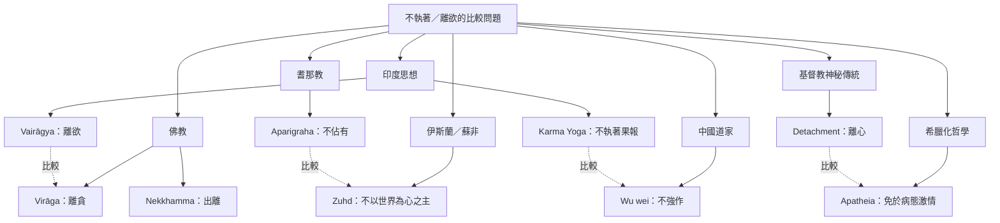

這張地圖並列多種宗教與哲學傳統如何處理欲望、佔有、情緒與行動。圖上的虛線表示可比較的功能或問題，不表示歷史影響、教義同一或完全可互換。

概念互鏈：[[term/Vairagya|Vairāgya]]、[[term/Nekkhamma|Nekkhamma]]、[[term/Viraga|Virāga]]、[[term/Aparigraha|Aparigraha]]、[[term/Zuhd|Zuhd]]、[[term/Detachment|Detachment]]、[[term/Apatheia|Apatheia]]、[[term/Wu_wei|Wu wei]]、[[term/Karma_yoga|Karma Yoga]]、[[term/Sannyasa|Sannyāsa]]。

閱讀入口：[[note/宗教離欲不是單一普世制度而是多種歷史道路]]、[[data/耆那教的不佔有同時處理外在財物與內在貪著]]、[[data/蘇非傳統的祖赫強調心不被世界占據且內含歷史爭論]]、[[data/艾克哈特的離心思想不必導向退隱而可與倫理行動並存]]、[[data/斯多噶的阿帕忒亞不是沒有情緒而是免於錯誤判斷支配]]、[[data/道家的無為提供不強作不強求的相近但不同路徑]]。

全書導讀：[[Vairagya|Vairāgya 導讀]]。
