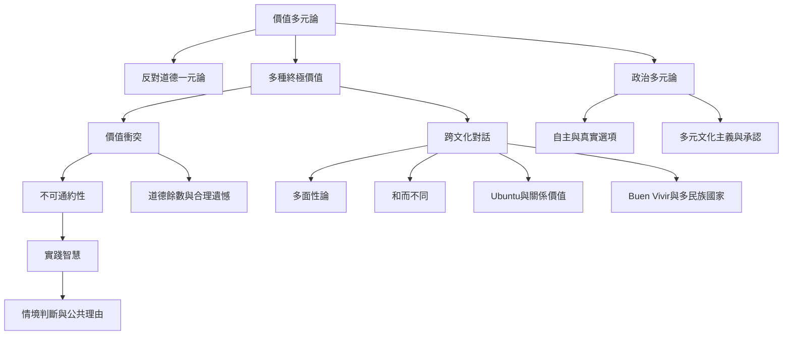

本圖以 Berlin 式價值多元論為主軸，連結其主要問題、政治含義與跨文化對照。核心不是把世界切成互不相干的價值，而是理解不同善何時能相容、何時產生真實衝突，以及人們如何在沒有單一總尺度時仍然負責任地判斷。

## 延伸連結
* 理論核心：[[價值多元論]]、[[道德一元論]]、[[不可通約性]]、[[道德餘數]]、[[實踐智慧]]。
* 政治與制度：[[政治多元論]]、[[自主]]、[[多元文化主義]]、[[承認政治]]。
* 跨文化對話：[[多面性論]]、[[和而不同]]、[[Ubuntu]]、[[多民族國家]]、[[關係價值]]。
* 核心永久筆記：[[價值多元論反對的是單一總排序而不是一切價值判斷]]、[[價值多元論不會自動推出自由主義]]、[[不可通約不等於不可比較或不能作出決定]]。
* 導讀：[[Value_pluralism]]。
