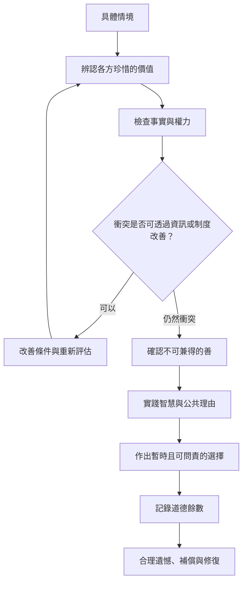

這張地圖把價值多元論從理論主張帶到實際判斷：先辨認不同價值，再區分資訊不足與真實衝突，接著運用理由與情境判斷作出選擇，最後保留損失、遺憾與修復責任。

## 延伸連結
* 核心概念：[[不可通約性]]、[[道德餘數]]、[[實踐智慧]]、[[多準則決策分析]]。
* 相關永久筆記：[[價值衝突有時是真實兩難而不是資訊不足造成的假問題]]、[[一個價值的實現可能造成另一個價值的真實損失]]、[[合理遺憾是承認價值損失而不是推翻決策]]、[[公共決策應同時呈現多種價值而不只公布總分]]。
* 實作靈感：[[建立價值衝突日誌以分辨假兩難與真兩難]]、[[建立多價值政策評估表以避免單一總分遮蔽代價]]、[[讓每次重大決策都保留未被選擇價值的修復清單]]。
* 導讀：[[Value_pluralism]]。
