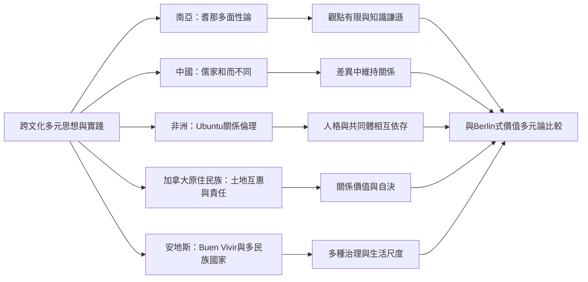

跨文化比較不是將所有傳統都歸入同一個「多元論」。本圖把不同脈絡看成可相互提問的思想與制度資源，並保留其問題意識、歷史與知識主體的差異。

## 延伸連結
* 南亞：[[多面性論]]、[[耆那哲學以多面性說明單一觀點不足以窮盡實在]]、[[古印度哲學家曾以多重立場進行跨學派的同理論述]]。
* 中國：[[和而不同]]、[[儒家和而不同可被重新理解為差異中維持關係的實踐]]。
* 非洲：[[Ubuntu]]、[[Ubuntu的關係倫理擴展了價值討論的共同體尺度]]。
* 原住民族與環境：[[關係價值]]、[[土地價值包含互惠與責任而不只是可計量的資源]]。
* 拉丁美洲：[[多民族國家]]、[[安地斯Buen Vivir與多民族國家挑戰單一發展尺度]]。
* 方法提醒：[[價值多元研究必須避免把文化差異本質化]]。
* 導讀：[[Value_pluralism]]。
