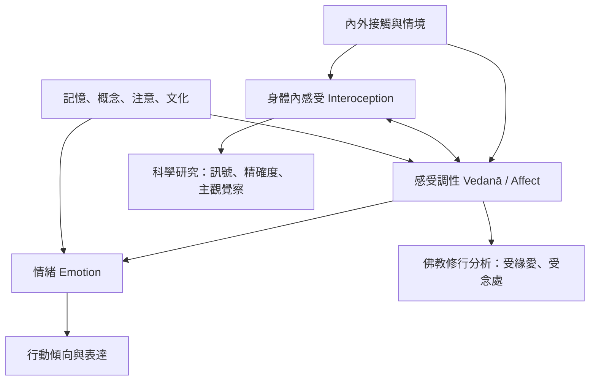

Vedanā、affect、interoception 與 emotion 都涉及感受經驗，但位於不同理論層次。佛教受偏向接觸後的苦樂調性及其與渴愛、解脫的關係；affect 是心理科學中對效價、喚起等經驗維度的研究用語；interoception 關注身體內部訊號如何被感知與處理；emotion 則通常指較複合的心理歷程。

概念比較只能建立功能上的對話，不能把術語、測量與理論視為互換。相關概念：[[受（Vedanā）]]、[[感受調性（Affect）]]、[[內感受（Interoception）]]、[[情緒（Emotion）]]、[[想（Saññā）]]、[[佛教受與現代 affect 可比較，但不能直接視為同一概念]]、[[身體內感受是理解情緒的重要訊號來源，但不是情緒的全部]]。
