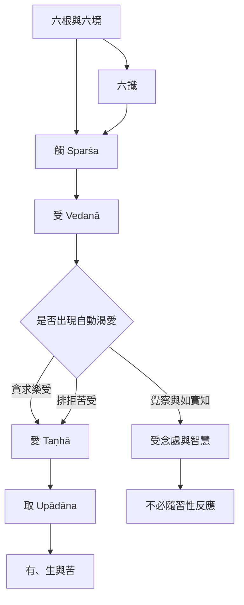

Vedana 在十二緣起中位於觸與愛之間。這張圖的重點不是把因果鏈理解為每次都必然發生的線性機械，而是辨識感受如何在特定條件下成為渴愛的條件。受念處與智慧的作用，是讓受與反應之間的習性關係得以被看見。

核心關聯：[[緣起]]、[[觸（Sparśa）]]、[[受（Vedanā）]]、[[愛（Taṇhā）]]、[[六根]]、[[受念處（Vedanānupassanā）]]、[[《因緣相應》指出觸是受的條件，而受又成為愛的條件]]、[[受與愛之間的條件關係，留下了不必自動反應的練習空間]]。
