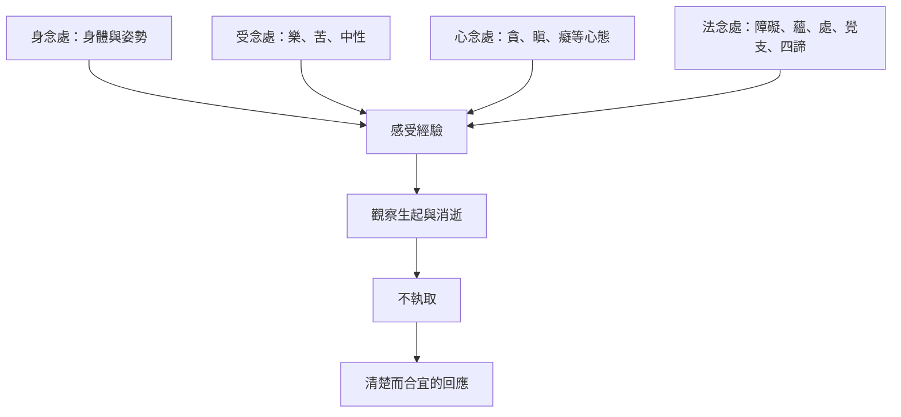

受念處位於四念處架構中，但不是孤立的感受分類表。身體狀態、感受調性、心的反應與法的條件可以彼此照明。觀察的焦點是經驗如何生起、變化與止息，而非把感受變成新的自我認同。

核心關聯：[[受念處（Vedanānupassanā）]]、[[受（Vedanā）]]、[[三受]]、[[平等心（Upekkhā）]]、[[無常（Anicca）]]、[[《念處經》把受念處設計為辨識感受並觀察其生滅]]、[[受念處把感受變成可觀察的過程，而非必須服從的命令]]。
