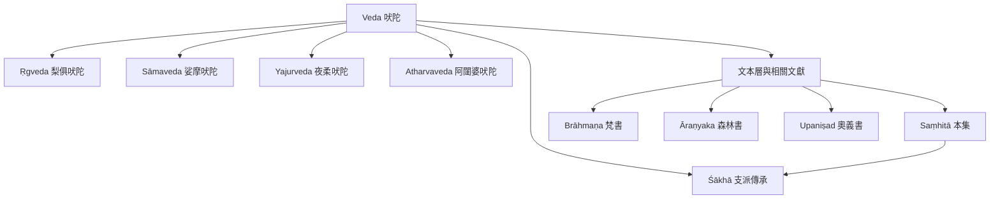

吠陀文獻的核心不是一個單一文本，而是四部吠陀、各自支派與不同歷史層次組成的文本家族。此圖先顯示分類關係，再提醒讀者文本層不必然以完全一致的方式出現在每一傳承中。

**互鏈概念**：[[吠陀是一個具有內部差異的文本家族]]、[[四部吠陀以不同媒介組織宗教知識]]、[[吠陀文本的年代應以層次和區域描述]]、[[Veda]]、[[Ṛgveda]]、[[Sāmaveda]]、[[Yajurveda]]、[[Atharvaveda]]、[[Saṃhitā]]、[[Brāhmaṇa]]、[[Āraṇyaka]]、[[Upaniṣad]]、[[Śākhā]]、[[Vedas]]。
