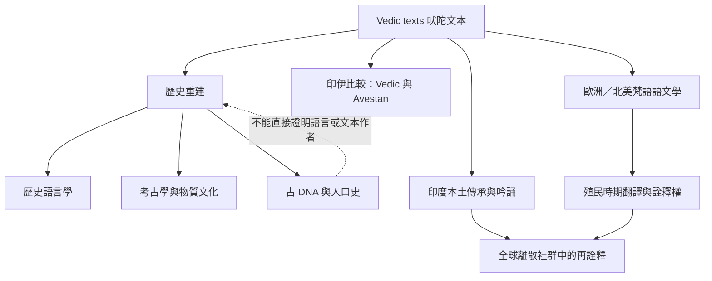

吠陀研究需要區分古代人口與語言史、印度本土傳承、伊朗比較、歐洲與北美的學術研究，以及近代翻譯和全球離散社群的再詮釋。此圖強調多種證據互補但不可互相取代。

**互鏈概念**：[[古 DNA 能限制歷史假說但不能替文本發聲]]、[[印伊比較能揭示共享遺產也能看見分化]]、[[翻譯既是語言轉換也是詮釋權的分配]]、[[吠陀與後期印度教必須建立歷史連續性而非同一性]]、[[Vedas]]、[[Vedas]]。
