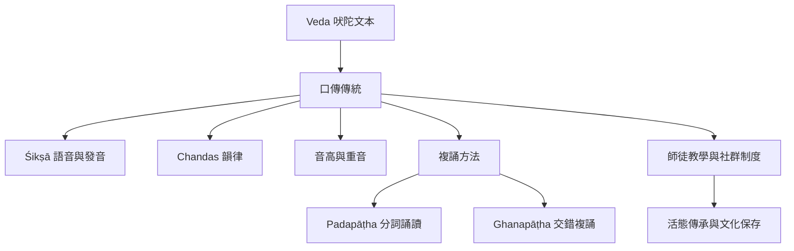

吠陀的口傳保存依賴聲音形式、複誦方法與師徒制度。此圖將文本、發音、韻律與社群分開，避免把口傳簡化為個人記憶能力。

**互鏈概念**：[[口傳不等於不精確而是另一種文本保存技術]]、[[神聖聲音的權威依賴可重複的身體訓練]]、[[吠陀傳承史同時是知識保存與知識排除的歷史]]、[[Mantra]]、[[Padapāṭha]]、[[Ghanapāṭha]]、[[Vedāṅga]]、[[Vedas]]。
