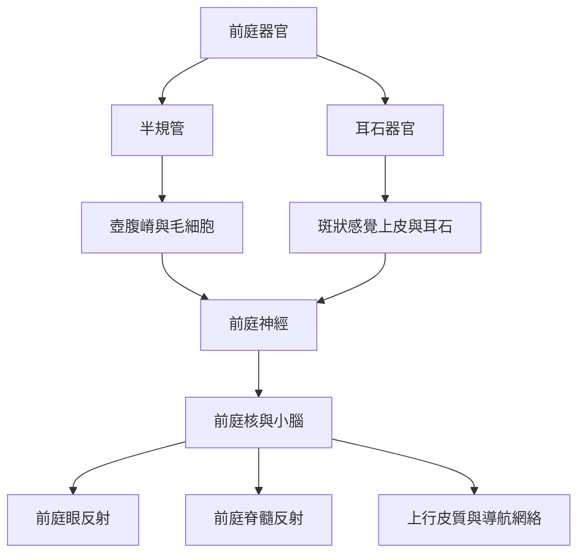

前庭器官將物理運動轉為神經訊號，再經腦幹、小腦與眼動／脊髓網絡形成反射及姿勢調節。理解這個層次時，需把感受器、傳入路徑與輸出功能分開。

## 思與行
* 依序閱讀感受器、神經傳導、反射輸出，再回頭理解整體系統。
* 使用[[前庭器官]]、[[半規管]]、[[耳石器官]]、[[前庭毛細胞]]、[[前庭核]]與[[前庭眼反射]]作為主要入口。

## 參考
* 依據：[[前庭系統把頭部運動訊號轉成視線穩定與空間定位所需的資訊]]、[[前庭反射把感覺訊號轉化為可觀察的眼動與姿勢行為]]。
