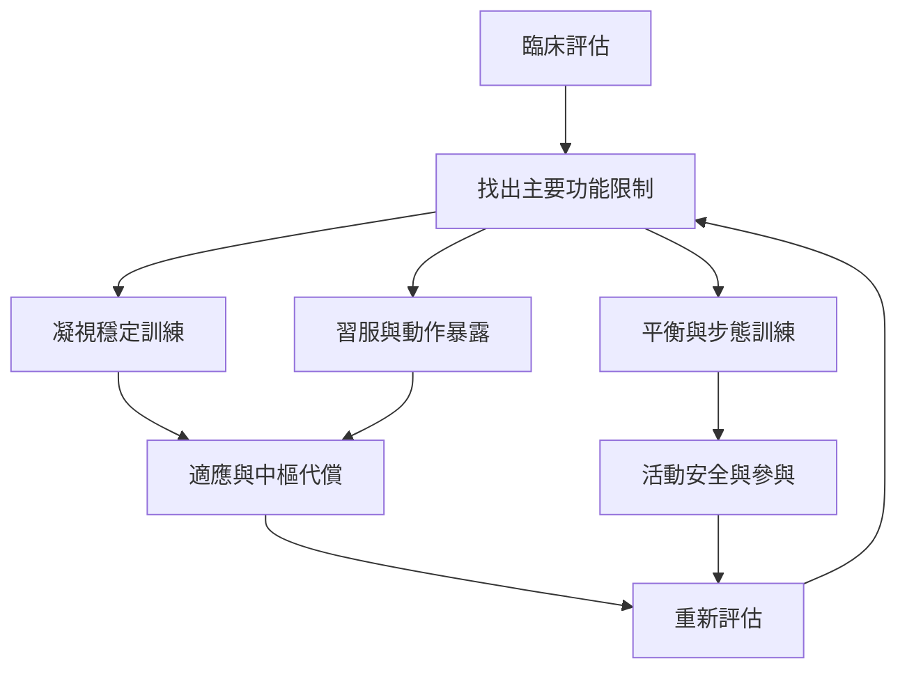

前庭功能下降後，復健透過逐步而有目標的任務，促進中樞代償、反射適應、感覺重新加權與日常功能恢復。適合的介入取決於診斷、病程、主要功能限制、風險與患者目標。

## 思與行
* 把復健視為反覆評估、處方、練習、回饋和調整的循環，而不是單次療程。
* 追蹤活動目標、症狀與安全性；不把固定劑量直接套用到所有疾病。

## 參考
* 依據：[[前庭復健藉由重複而漸進的任務促進中樞代償]]、[[前庭低功能的復健劑量必須依疾病階段和個人反應調整]]。
