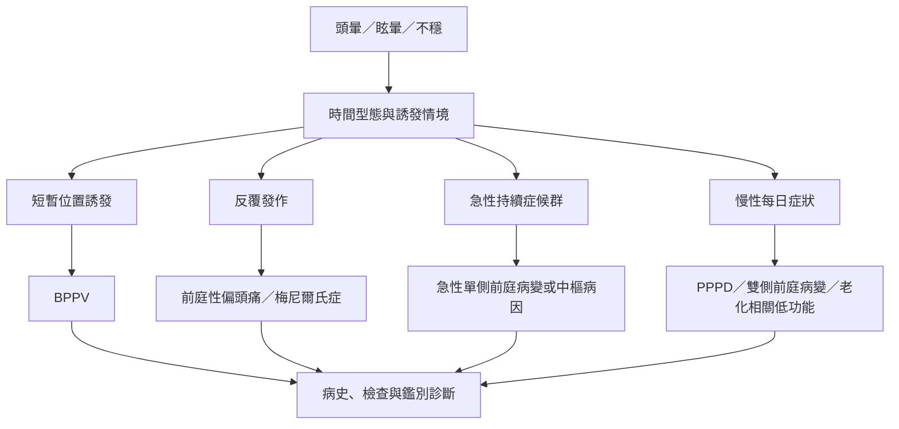

暈眩是症狀，不是單一診斷。臨床分類須依時間型態、誘發方式、聽覺與神經學伴隨症狀，以及前庭檢查來辨識可能病因。不同疾病可重疊或共存，診斷準則提供的是分類共同語言，不是自我診斷清單。

## 思與行
* 把每種疾病的診斷條件、典型時間軸、聽覺徵象、神經警訊與檢查結果各自整理，不以單一症狀決定診斷。
* 在公共衛教中清楚標示哪些情況需要緊急醫療評估。

## 參考
* 依據：[[暈眩的臨床分類必須從時間型態與誘發情境開始]]、[[急性單側前庭病變必須先排除中樞神經與聽覺警訊]]。
