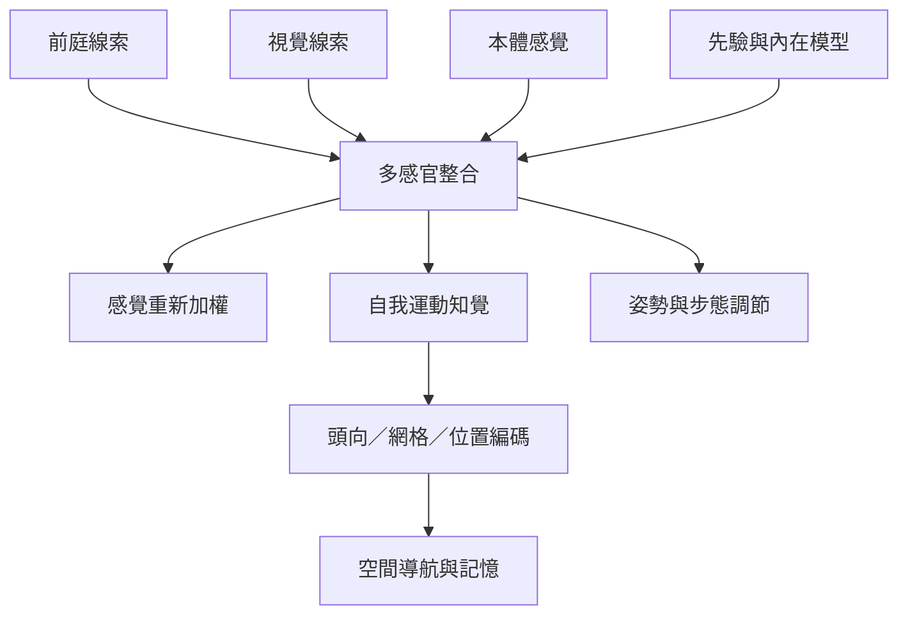

前庭訊號從內耳開始，但它的功能必須放在多感官整合與空間認知網絡中理解。視覺、本體感覺和內在預測共同影響身體對重力、方向與自我運動的估計；前庭訊號也進入海馬迴相關導航網絡。

## 思與行
* 把前庭研究連接到[[多感官整合]]、[[貝葉斯推論]]、[[感覺重新加權]]與[[空間導航]]，形成跨領域閱讀路徑。
* 思考在虛擬實境、交通、建築與導航介面中，如何降低不必要的感覺衝突。

## 參考
* 依據：[[視覺前庭與本體感覺會依可靠程度動態重新加權]]、[[耳石訊號透過頭向細胞與海馬迴網絡參與空間導航]]。
