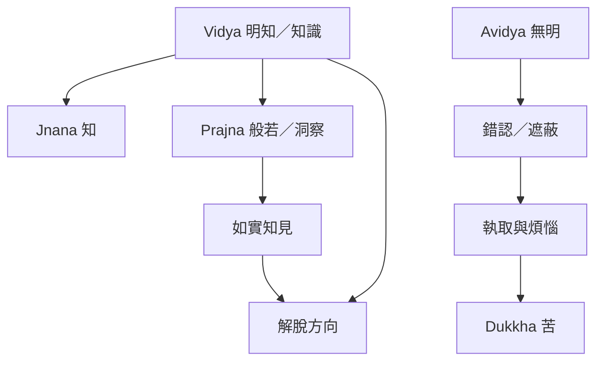

Vidyā 與 avidyā 的對照在印度思想中具有重要位置，但不同傳統對「明」與「無明」的定義並不完全相同。此地圖以認知誤認、洞察與解脫為中心，呈現佛教、瑜伽與不二吠檀多間可比較但不可混同的概念。

關聯閱讀：[[佛教的無明是對四聖諦與緣起的根本誤解]]、[[無明常是積極錯認而非資訊空白]]、[[解脫知識同時是認知轉化與生活方向]]、[[Vidya]]、[[Avidya]]、[[Jnana]]、[[Prajna]]、[[Moksha]]、[[Anatta]]、[[Dependent_Origination]]。
