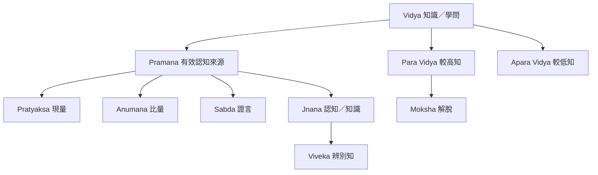

印度哲學知識論以 pramāṇa（有效認知來源）為重要議題，並在多個哲學學派之間形成持續辯論。此地圖由知識的語義、來源與認知方式，連結到不同學派對解脫的理解。

關聯閱讀：[[印度哲學知識論的核心是如何判定認知來源有效]]、[[部分印度哲學主張認知在未被推翻前具有內在有效性]]、[[知識來源與知識內容必須分開分析]]、[[Vidya不宜直接等同現代命題知識]]、[[Vidya]]、[[Pramana]]、[[Pratyaksa]]、[[Anumana]]、[[Sabda]]、[[Para_Vidya]]、[[Apara_Vidya]]、[[Viveka]]、[[Moksha]]。
