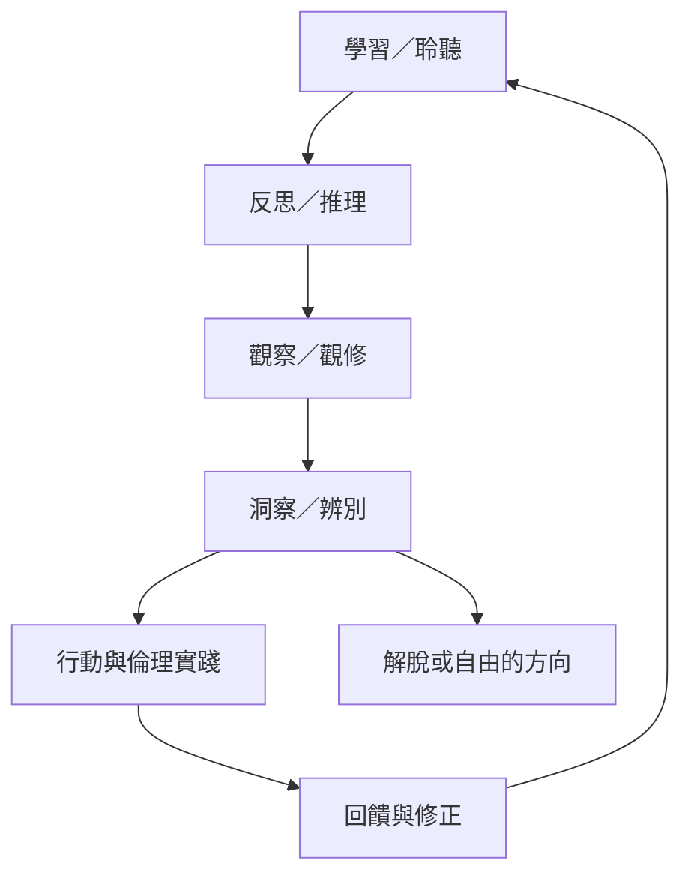

本地圖把知識放進實踐脈絡：學習、聆聽、推理、觀修、道德行動與回饋，如何共同促成理解與轉化？它不主張所有傳統採取同一修行路徑，而是提供比較時可追問的關係結構。

關聯閱讀：[[商羯羅將聆聽思辨與觀修串成解脫知識的路徑]]、[[當代訪談凸顯教理知識必須轉化為修行與倫理行動]]、[[第一人稱體驗需要與論證和共同檢驗互補]]、[[將讀書所得轉成可被行為檢驗的知]]、[[用教學回饋檢查自己是否真正理解]]。
