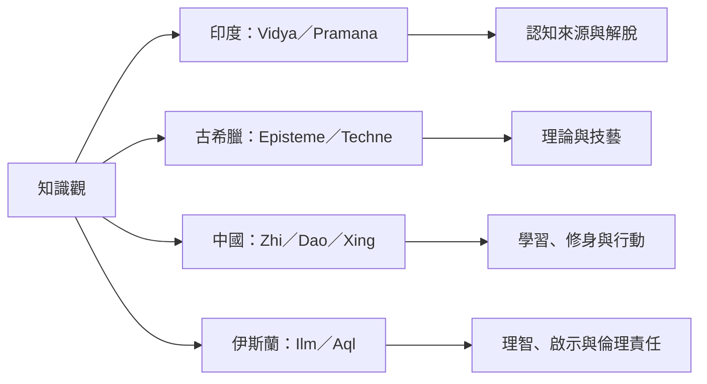

跨文化比較的重點不是把不同語言的「知識」視為同義詞，而是分析每種傳統如何理解知識來源、知識主體、實踐、倫理與究竟目標。印度 vidyā、古希臘 epistēmē、中國 zhī 與伊斯蘭 ʿilm 彼此可以對話，但各自擁有不同思想史。

關聯閱讀：[[中國哲學把知識放在修身與實踐的關係中]]、[[古希臘 episteme 和 techne 的界線隨哲學家而變]]、[[伊斯蘭思想把知識視為理智探究與精神使命]]、[[知行關係是跨文化比較的重要軸線]]、[[Zhi]]、[[Ilm]]、[[Episteme]]、[[Techne]]、[[Vidya]]。
