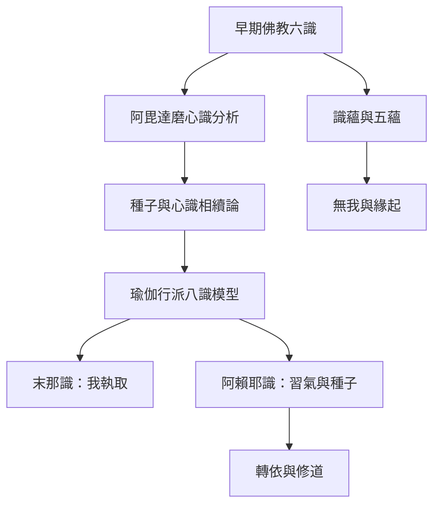

這張圖以思想史方式呈現從早期佛教六識分析，到阿毘達磨的心識事件分析，再到瑜伽行派八識模型的理論擴展。它不是線性進步史：不同學派長期並存，並以不同方式解釋感官認知、連續性與自我執取。

閱讀時先看[[六識]]與[[識蘊]]，再讀[[心]]和[[心所]]，接著進入[[阿賴耶識]]、[[末那識]]與[[唯識]]。重要提醒是：八識是哲學分析模型，不是八個腦器官。

與[[緣起與無我概念地圖]]、[[瑜伽行派八識與轉依概念地圖]]相互參照。
