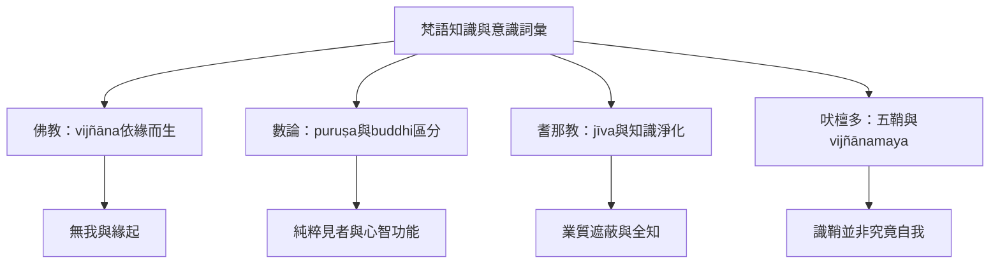

印度哲學共享許多詞彙，卻不共享同一套主體論。佛教以無我和條件性分析識；瑜伽行派建立層次化識論；數論區分 puruṣa 與 buddhi；耆那教把 jīva 理解為可顯現無礙知識的生命主體；吠檀多的五鞘分析又以不同方式定位 vijñānamaya。這張圖是比較入口，而不是將各傳統強行統一。

閱讀時先看[[Vijñāna]]與[[Jñāna]]，再讀[[Buddhi]]、[[Puruṣa]]、[[Jīva]]及[[五鞘]]。跨傳統翻譯請參照[[跨傳統比較必須區分知識能力與本體意識]]。

與[[佛教六識到八識的思想演變概念地圖]]相互參照。
