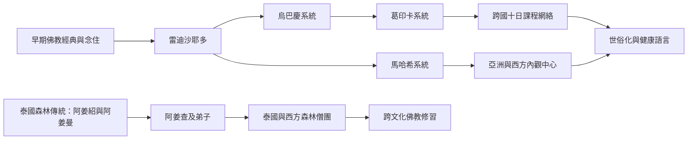

本圖強調現代內觀不是單線由古代直接延伸的固定制度，而是經典資源、緬甸近代改革、不同老師與跨國社群共同形成的多條路線。緬甸的雷迪、馬哈希與烏巴慶影響全球內觀運動；泰國森林傳統則構成相關但不同的修習脈絡。

## 關聯筆記
* [[近代緬甸的在家內觀運動是歷史形成的現象]]、[[內觀的全球化同時是社會與宗教史]]、[[世俗化不等於宗教脈絡消失]]。
* [[不同傳承的修習差異需要放在歷史脈絡理解]]、[[內觀會重塑自我經驗也重塑社群關係]]。

## 區域研究補充
* [[data/斯里蘭卡近代在家禪修運動挑戰單一民族佛教敘事]]、[[data/斯里蘭卡殖民時期的禪修多樣性被現代內觀敘事簡化]]。
* [[data/尼泊爾在家修習者調查呈現葛印卡課程的本地生活經驗]]、[[data/尼泊爾的課程中心顯示內觀已融入多語地方社群]]。
* [[data/《緬甸大眾在家禪修運動》把內觀放回權力與政治生活]]、[[data/泰國清邁的馬哈希系內觀呈現地方寺院與跨國修習網絡]]。

## 概念條目
[[內觀 Vipassana]]、[[止 Samatha]]、[[觀 Vipassana-bhavana]]、[[修習 Bhavana]]、[[布施 Dana]]。
