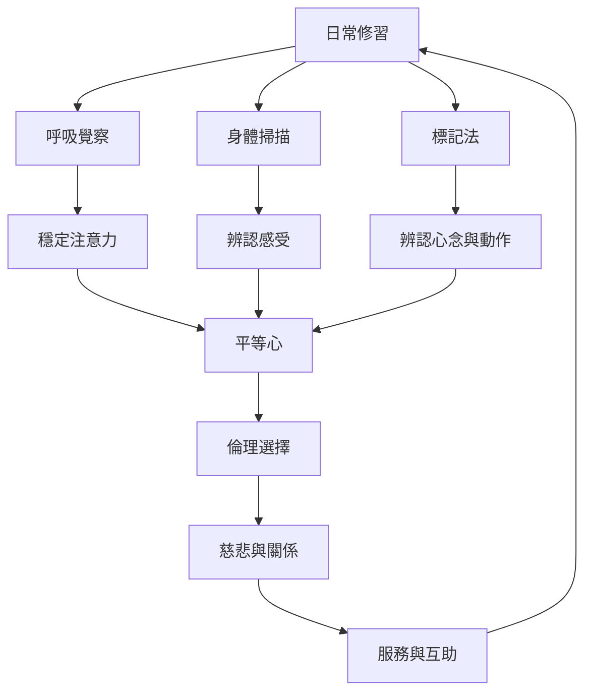

此圖將練習從課程環境延伸到日常生活：呼吸、身體感受與標記是可能的練習入口；覺察之後要回到戒行、平等心、慈悲、人際互動與服務。修習成果不只用靜坐中的感覺衡量，也要觀察生活是否更少傷害、更清明且更能照顧他人。

## 關聯筆記
* [[把平等心練習轉化成日常互動中的非反應空間]]、[[把禪修後的生活整合納入修習評估]]。
* [[以互助而非個人英雄主義理解禪修服務]]、[[設計一份不浪漫化痛苦的禪修安全與支持協議]]。

## 概念條目
[[入出息念 Anapanasati]]、[[標記 Noting]]、[[身體掃描 Body scan]]、[[平等心 Upekkha]]、[[布施 Dana]]。
