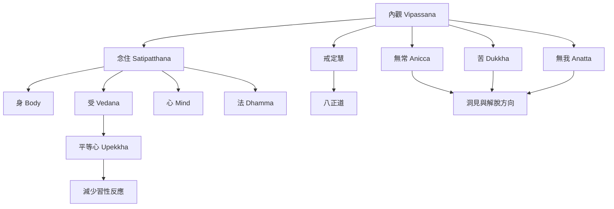

本圖把內觀的修習架構、觀察對象與解脫論放在同一張概念地圖。四念住是觀察範圍，受與平等心呈現反應鏈條，無常、苦、無我則是洞見方向；戒定慧與八正道提供整體修道條件。

## 關聯筆記
* [[內觀不是單一固定的技術]]、[[念住是早期佛教觀察身心的整體架構]]、[[戒定慧是互相支援的訓練]]。
* [[無常觀察把經驗理解為不斷變化的過程]]、[[苦與不滿足指出執取的脆弱性]]、[[無我觀察鬆動固定自我實體的想像]]。
* [[感受調性是反應鏈條中值得細察的環節]]、[[平等心是在感受變化中減少習性反應]]。

## 概念條目
[[內觀 Vipassana]]、[[念住 Satipatthana]]、[[入出息念 Anapanasati]]、[[受 Vedana]]、[[平等心 Upekkha]]、[[無常 Anicca]]、[[苦 Dukkha]]、[[無我 Anatta]]、[[戒 Sila]]、[[定 Samadhi]]、[[慧 Panna]]、[[八正道 Noble Eightfold Path]]、[[涅槃 Nibbana]]。
