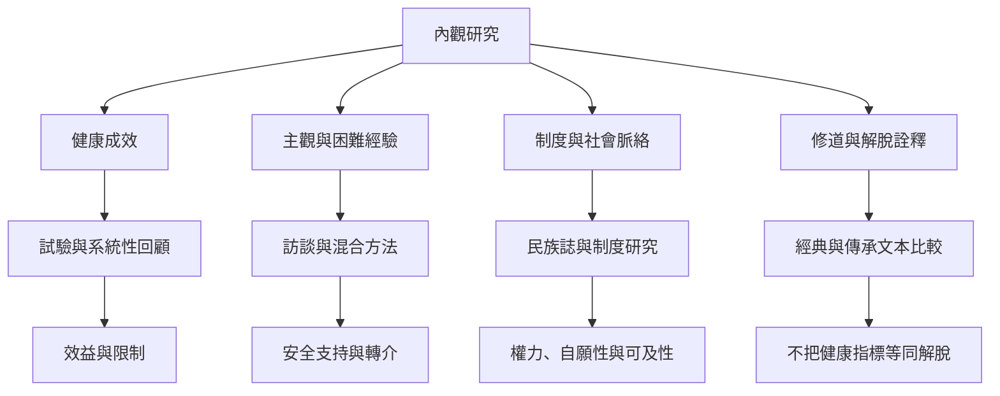

此圖把內觀研究的不同問題分開：健康成效、經驗現象、密集修習安全、制度介入和修道詮釋。不同資料類型需要不同的推論標準；系統性回顧不能取代質性訪談，課程官方介紹也不能直接證明效果。

## 關聯筆記
* [[內觀研究的正向結果不能直接等同解脫的證據]]、[[禪修困難經驗需要被描述與照護而非一概解釋]]。
* [[密集修習的收益與風險都需要長期追蹤]]、[[把內觀帶入監獄必須同時處理自由與權力問題]]。

## 研究資料
[[2025年系統性回顧顯示內觀健康研究有初步正向訊號但證據仍有限]]、[[2017年禪修困難經驗研究整理出七類經驗與多種影響因素]]、[[2020年研究提醒老師應區分修行轉變與功能受損]]、[[德里提哈監獄的官方資料記錄了大規模內觀課程實踐]]。
