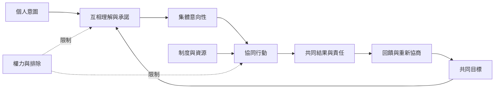

個人意志並非總在孤立狀態中運作。共同目標、互相承諾、制度規則與資源安排，可以使人們共同採取行動；但群體也可能因權力不對等而壓縮成員的自主性。

## 參考
* [[集體意向性使共同目標成為協同行動]]、[[自主性可以在互賴關係中形成]]、[[意志的社會條件決定哪些選擇實際可行]]。
* [[集體意向性（Collective intentionality）]]、[[關係性自主（Relational autonomy）]]、[[能動性（Agency）]]。
