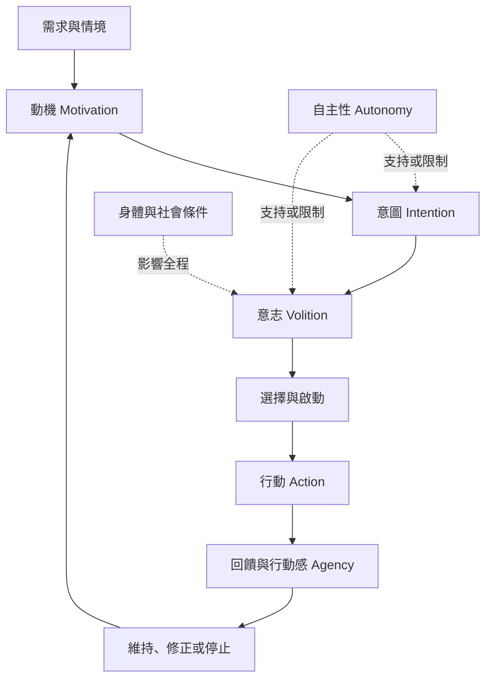

意志是心理活動轉化為行動的過程，必須和動機、意圖、能動性、行動感及自由意志分辨。可用「形成—選擇—啟動—維持—修正」理解其時間結構。

## 參考
* [[意志是把心理活動轉化為行動的能動過程]]、[[意志與意圖相連但不能完全互換]]、[[意志包含從選擇到持續實踐的時間尺度]]、[[意志具有第一人稱與第三人稱兩種研究視角]]。
* [[意志（Volition）]]、[[動機（Motivation）]]、[[意圖（Intention）]]、[[能動性（Agency）]]、[[自主性（Autonomy）]]。
