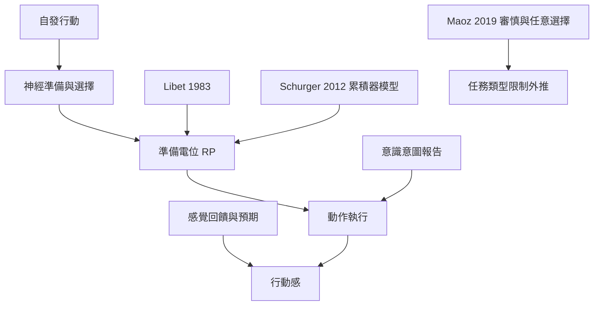

神經科學研究意志時，應區分動作準備、行動選擇、意識意圖與行動感。Libet 實驗是重要歷史起點，但準備電位的替代模型與審慎決策研究限制了它可支持的結論。

## 參考
* [[Libet 實驗發現準備電位早於受試者回報的有意識行動意圖]]、[[準備電位可能反映自發神經波動累積而非完整決策已提前完成]]、[[審慎決策與任意動作需要不同的研究範式]]、[[行動感是對控制關係的主觀經驗]]。
* [[準備電位不能單獨證明自由意志不存在]]、[[神經機制與自由意志是不同層次的問題]]。
