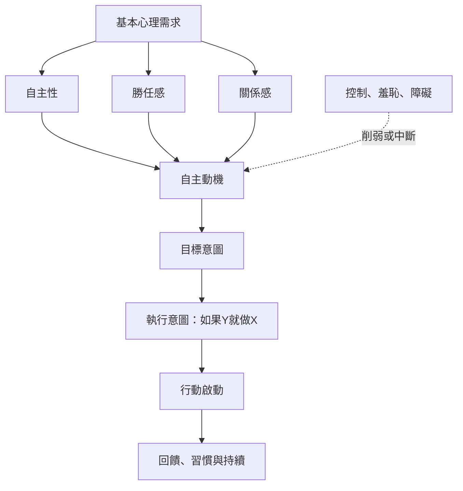

自我決定理論解釋動機品質如何受到自主性、勝任感與關係感支持；執行意圖則說明如何將目標變成情境中的具體行動。意志的實踐不只是更努力，也包含支持條件與行動設計。

## 參考
* [[自我決定理論將自主性、勝任感與關係感視為動機的重要心理需求]]、[[自主支持比控制壓迫更能促進內在動機與持續投入]]、[[執行意圖能把抽象目標轉成遇到情境時可啟動的具體行動]]。
* [[意志的培養需要支持而不只是施壓]]、[[意志能透過情境設計而不是單靠硬撐來實踐]]。
