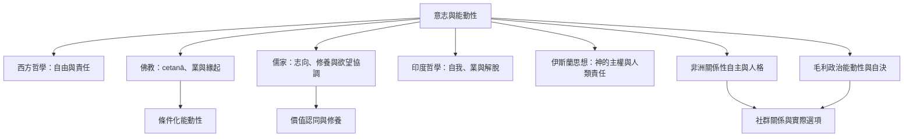

跨文化材料顯示，意志可在個人自我治理、道德修養、因果與業、神人關係、社群責任及政治自決等不同脈絡中被理解。比較時既要保留共通問題，也要尊重各傳統概念不能完全互譯之處。

## 參考
* [[峇里島與美國的比較顯示意志概念具有跨文化共通性也具有文化差異]]、[[跨二十國研究顯示人們對自由意志與責任的判斷會受文化脈絡影響]]。
* [[佛教的 cetanā 是受條件制約又能改變後續行動的意志活動]]、[[儒家自由觀重視主觀肯定善與調整欲望使其與善一致]]、[[印度哲學各傳統對自由意志、能動性與自我有多種不同答案]]、[[伊斯蘭思想中的人類意志圍繞神的全能與人的責任展開辯論]]、[[非洲關係性自主觀把個人選擇放回社群與人格形成的脈絡]]、[[毛利政治能動性研究呈現集體自決與制度限制之間的張力]]。
