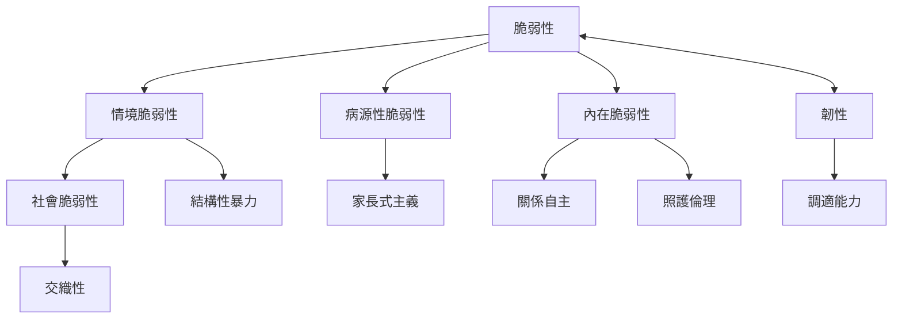

脆弱性可從共同的人類具身條件、具體情境與制度關係三個層次理解。內在脆弱性不是缺陷；情境脆弱性指出風險如何被環境塑造；病源性脆弱性則提醒保護措施也可能加重傷害。分類時還要區分脆弱性的來源與狀態。

概念節點：[[脆弱性]]、[[內在脆弱性]]、[[情境脆弱性]]、[[病源性脆弱性]]、[[傾向性脆弱與當下脆弱狀態]]、[[社會脆弱性]]、[[結構性暴力]]、[[韌性]]、[[調適能力]]、[[關係自主]]。

延伸閱讀：[[脆弱性是普遍處境但傷害風險由制度不均等分配]]、[[脆弱性的三種來源與兩種狀態不能混為一談]]、[[保護措施也可能製造新的脆弱性]]。

總覽：[[Vulnerability]]。
