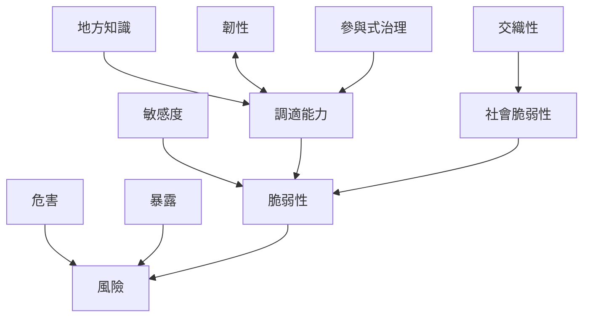

災害與氣候風險不是自然危害單獨造成的結果，而是危害、暴露、敏感度、脆弱性與調適能力交互作用。社會資源、地方知識、基礎設施與參與式治理，會改變人們如何承受衝擊與恢復生活。

概念節點：[[危害與風險]]、[[暴露]]、[[敏感度]]、[[脆弱性]]、[[社會脆弱性]]、[[調適能力]]、[[韌性]]、[[地方知識]]。

延伸閱讀：[[災害風險必須同時理解危害暴露脆弱性與能力]]、[[脆弱性指標必須讓地方經驗修正統計模型]]、[[地方知識能補足外來風險模型看不見的生活脈絡]]。

總覽：[[Vulnerability]]。
