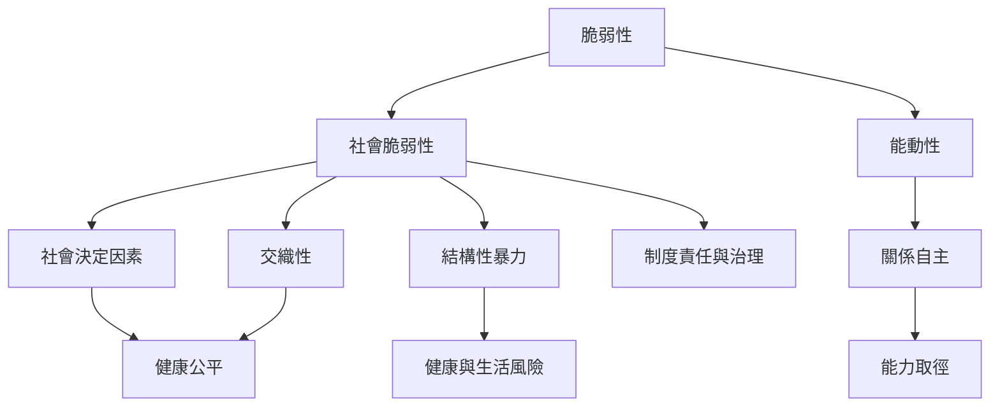

社會正義取徑不把脆弱性當成群體身分，而分析制度、資源與權力如何分配風險。健康、災害、移民與障礙議題都需要辨識多重不平等如何在具體生活情境中交會，也要保留當事人的能動性與參與權。

概念節點：[[社會脆弱性]]、[[社會決定因素]]、[[結構性暴力]]、[[交織性]]、[[能動性]]、[[關係自主]]、[[照護倫理]]。

延伸閱讀：[[脆弱性理論把政策焦點從身分標籤移向制度責任]]、[[結構性脆弱性讓健康照護看見個人病史之外的制度條件]]、[[交織性分析能辨識多重不平等如何共同作用]]。

總覽：[[Vulnerability]]。
