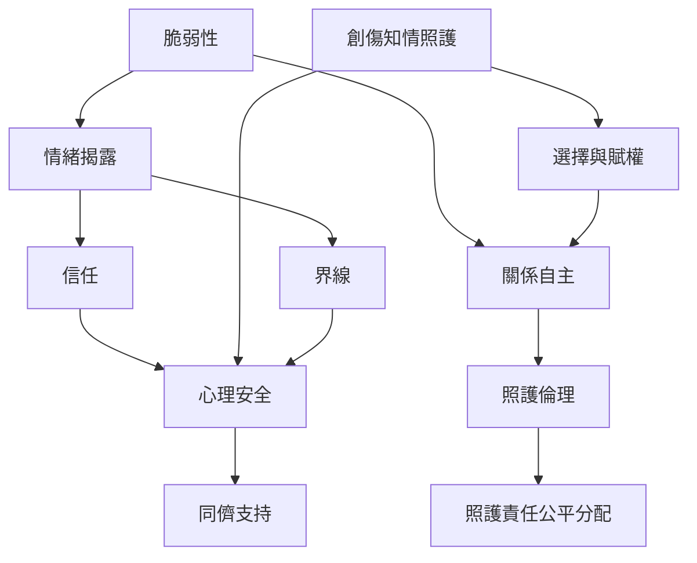

關係倫理把脆弱性放在信任、揭露、照護、互賴與自主性的關係中理解。情緒揭露可能促進連結，但必須保有選擇與界線；照護要讓支持增加自主，而不是把人固定成被保護者或照顧者。

概念節點：[[關係自主]]、[[照護倫理]]、[[情緒揭露]]、[[羞愧與羞恥]]、[[心理安全]]、[[創傷知情照護]]、[[能動性]]。

延伸閱讀：[[情緒脆弱性可以促進連結但不構成自我揭露義務]]、[[照護責任的公平分配是脆弱性政治的核心]]、[[安全與選擇比要求揭露更能支持受創者的自主]]。

總覽：[[Vulnerability]]。
