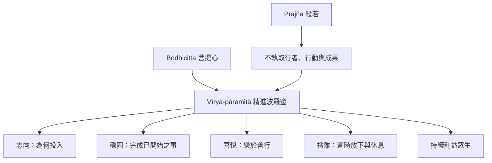

大乘精進波羅蜜將精進放進菩薩長程利他實踐。寂天以喜愛善法說明其核心，並指出志向、穩固、喜悅與捨離可以共同支持行動。般若與菩提心提供方向：持續利益眾生，同時不執取行者與成果。

可沿著 [[精進波羅蜜以喜悅投入取代道德化的苦撐]]、[[菩薩精進把個人修持擴展為利他承諾]]、[[休息與放下是成熟精進的調節能力]]、[[Vīrya-pāramitā（精進波羅蜜）]]、[[Bodhicitta（菩提心）]]與[[Prajñā（般若／智慧）]]閱讀。

## 參考
* [[寂天以喜愛善法界定精進並分析四種增上力量]]。
* [[大智度論把精進波羅蜜連結身心努力與不取法相]]。
* [[Vīrya]]
