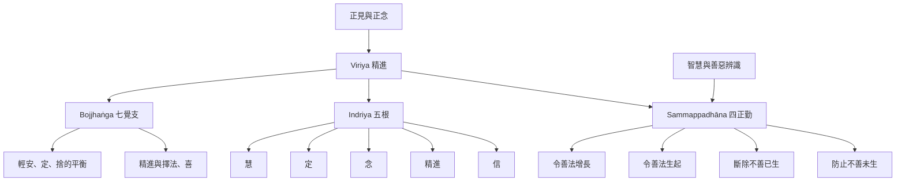

早期佛教文獻把精進放進多個相互關聯的修道分類。四正勤說明精進處理什麼心行；五根凸顯精進與信、念、定、慧共同成長；七覺支則呈現精進如何與喜、輕安、定、捨調節。它們不是三套互斥技巧，而是對修行的工作、能力與平衡分別描述。

重要閱讀入口包括 [[四正勤提供了辨認精進方向的操作框架]]、[[正精進是八正道中調整心行的實踐]]、[[精進在五根與七覺支中既供能也受平衡]]、[[Sammā-vāyāma（正精進）]]、[[Sammappadhāna（四正勤）]]、[[Indriya（根）]]與[[Bojjhaṅga（覺支）]]。

## 參考
* [[早期經典把正精進定義為防止不善與培育善法的四項工作]]。
* [[五根中的精進根需要與信念正念定慧共同運作]]。
* [[Vīrya]]
