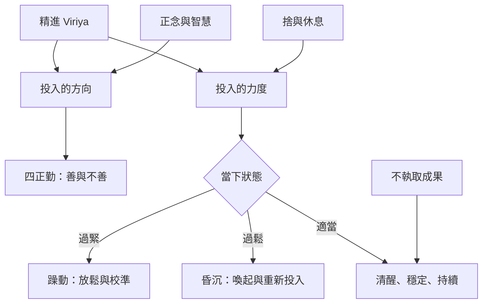

精進的實踐需要同時調節能量、清醒與執取。努力過強可能變成躁動，努力不足可能落入昏沉；非努力（non-striving）提醒人不執取某個理想體驗，但不能因此放棄有方向的投入。現代研究對清醒喚起與非努力的討論，可以補充問題意識，不能取代佛教原典的規範性分析。

可連讀 [[過度用力與鬆懈都會使精進失調]]、[[正念禪修不能被理解為純放鬆或純奮鬥]]、[[精進與不執取可以同時成立]]、[[Sati（念／正念）]]、[[Samādhi（定）]]與[[Upekkhā（捨／平等心）]]。

## 參考
* [[琴弦譬喻指出精進必須調音而不是持續加壓]]。
* [[佛教禪修的清醒活力是放鬆與昏沉之外的重要面向]]。
* [[正念非努力研究指出目標行動與不執取必須同時存在]]。
* [[Vīrya]]
