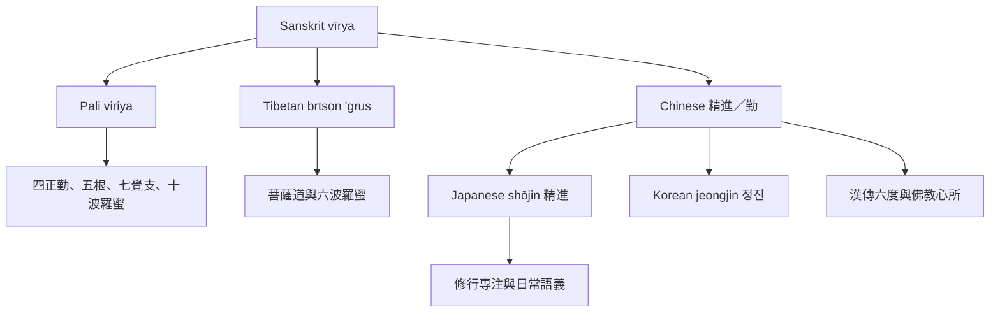

Vīrya 的跨文化傳播需要保留原語與譯語之間的關係，而非將所有詞彙等同於單一英文 diligence。梵文與巴利語提供印度佛教的術語來源；藏文、漢文、日文與韓文則呈現不同翻譯史與宗派語境。共同核心是投入善行與持續活力，具體解釋仍需回到各自文本。

相關筆記：[[精進的跨語言傳播保留共同核心也產生傳統差異]]、[[Vīrya（精進）]]、[[Viriya（精進的巴利語形態）]]、[[Brtson ’grus（藏文精進）]]、[[精進（漢譯術語）]]、[[Shōjin（日文精進）]]。

## 參考
* [[漢藏日韓譯名呈現精進概念的跨文化流動]]。
* [[佛教術語資料庫顯示精進的漢譯與日韓對應並非單一英文詞]]。
* [[Vīrya]]
