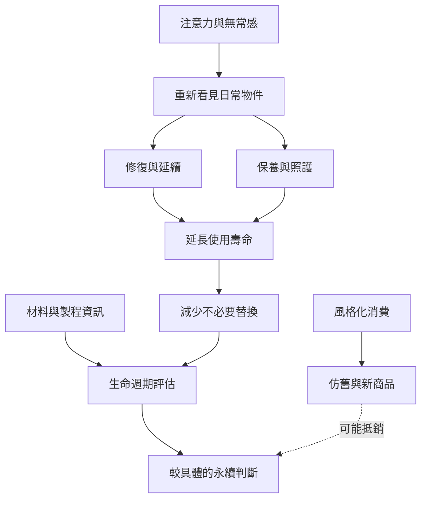

本圖把侘寂的當代實踐從購買風格移向注意力、照護、修補、共享與生命週期。美感可以支持珍惜，但實際永續仍需要可檢驗的材料與使用證據。

概念節點：[[侘寂]]、[[無常]]、[[金繼]]、[[民藝]]、[[勿體無]]、[[修復]]。

延伸閱讀：[[侘寂的生活實踐應從注意力而非購物開始]]、[[可持續設計要把耐用維修與生命週期納入美感]]、[[侘寂的商業化可能把反消費變成新的消費]]。

本書導讀：[[Wabi-sabi]]
