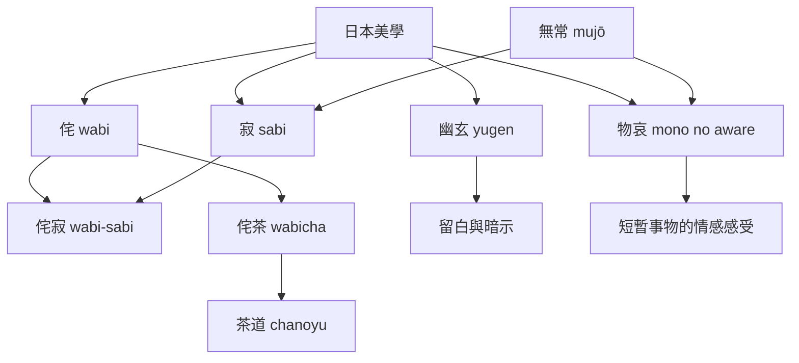

本圖將侘寂放回日本美學的概念群，區分無常、物哀、侘、寂與幽玄等相鄰但不相同的概念。其核心不是建立一條單向起源線，而是呈現它們在詩歌、茶道、物件與空間中的交會。

概念節點：[[日本美學]]、[[侘]]、[[寂]]、[[侘寂]]、[[無常]]、[[物哀]]、[[幽玄]]、[[渋味]]。

延伸閱讀：[[日本美學是一組彼此區別又互相映照的概念]]、[[侘與寂在歷史上有不同語義與發展路徑]]、[[無常讓美感從永恆完成轉向當下關係]]。

本書導讀：[[Wabi-sabi]]
