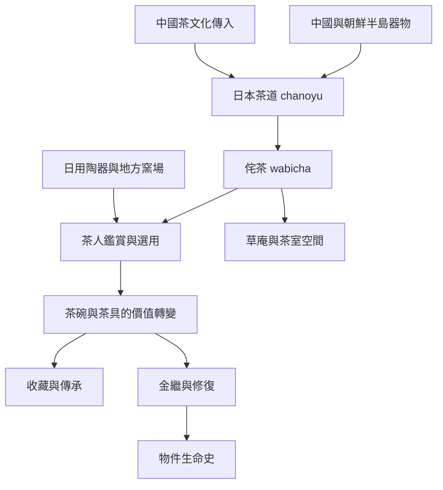

本圖呈現茶道、侘茶、器物、材料與修復之間的關係。器物不只是被觀看的物件，也在製作、使用、收藏、修復與展示的過程中取得不同意義。

概念節點：[[茶道]]、[[侘茶]]、[[茶碗]]、[[樂燒]]、[[躙口]]、[[金繼]]、[[修復]]、[[民藝]]。

延伸閱讀：[[日本茶道的茶器價值來自使用脈絡與鑑賞共同作用]]、[[中國與朝鮮半島的交流是日本茶文化形成的重要條件]]、[[修復延續物件關係而不是把損傷抹除]]。

本書導讀：[[Wabi-sabi]]
