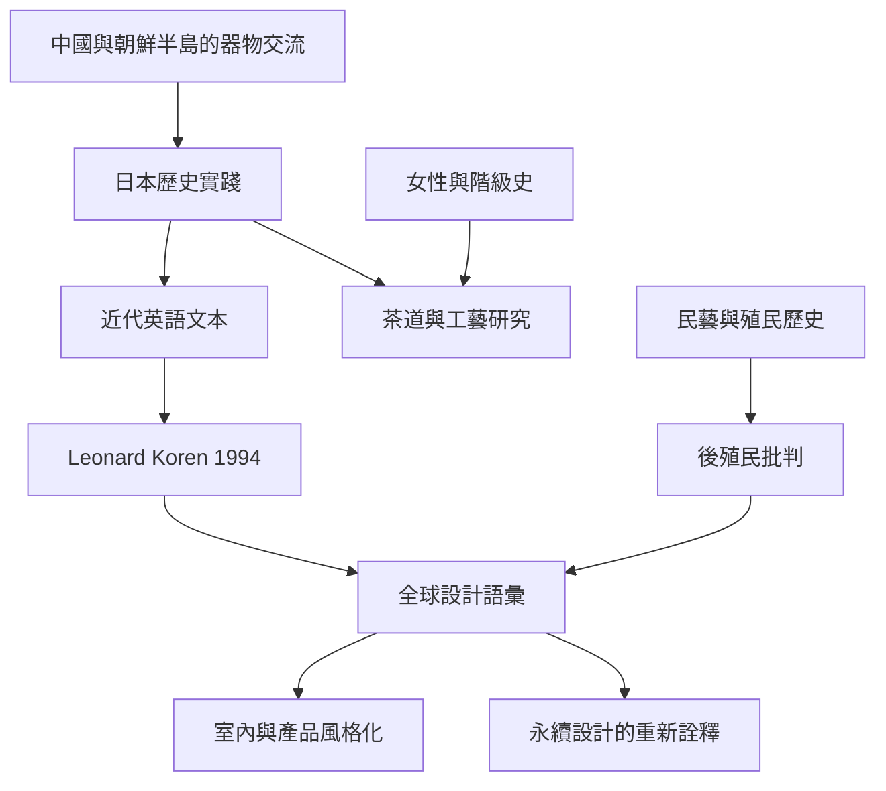

侘寂從日本茶道、詩歌與工藝語境移動到英語出版、歐洲設計論述與全球產品設計時，並非原封不動地傳播。本圖整理翻譯、商品化、文化交流與殖民史之間的關係。

概念節點：[[侘寂]]、[[茶道]]、[[民藝]]、[[勿體無]]、[[修復]]。

延伸閱讀：[[西方對侘寂的理解常把歷史概念轉化為設計趨勢]]、[[民藝與朝鮮半島的關係需要納入殖民史檢視]]、[[跨文化借用需要交代來源與權力關係]]。

本書導讀：[[Wabi-sabi]]
