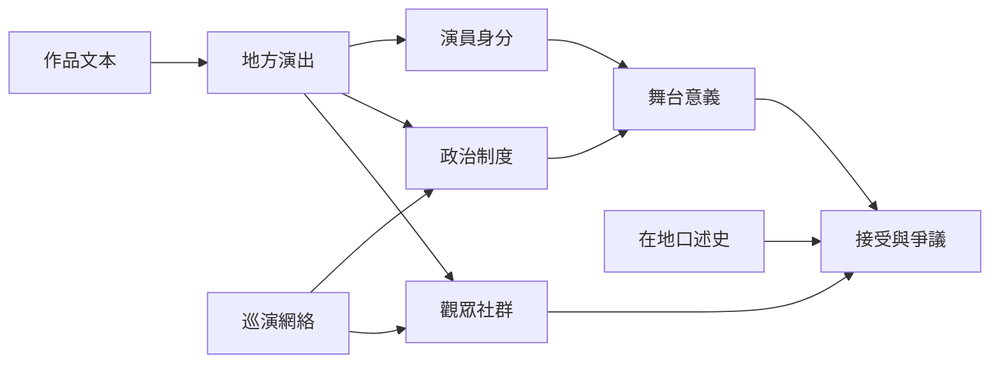

本圖把作品的演出史放回具體政治與社會現場，避免將全球流通簡化成「普遍人性」的成功故事。美國黑人演員與監獄演出、南非種族隔離時期演出、薩拉熱窩圍城劇場，以及不同地區的巡演接受，都顯示文本意義會隨演員、觀眾與制度改變。建議從 [[普遍性主張必須接受歷史位置的檢驗]] 與 [[作品的政治意義會在巡演路徑與觀眾網絡中改變]] 開始。

概念入口：[[政治劇場]]、[[觀眾接受]]、[[種族化荒謬]]、[[監獄劇場]]、[[制度時間]]、[[荒謬]]。

案例材料：[[1957年黑人演員復排把荒謬劇放回種族現代性的歷史]]、[[聖昆丁監獄演出讓等待成為被囚禁者的切身經驗]]、[[1976年南非全黑人演出把波卓與幸運兒的支配關係帶入種族隔離現場]]、[[1980至1981年南非跨種族巡演顯示政治劇場的接受並不一致]]、[[1993年薩拉熱窩圍城演出把等待轉化為共同承受的現場行動]]。

延伸到 [[MOC｜身體、性別與權力]] 與 [[MOC｜翻譯與跨文化流通]]。
