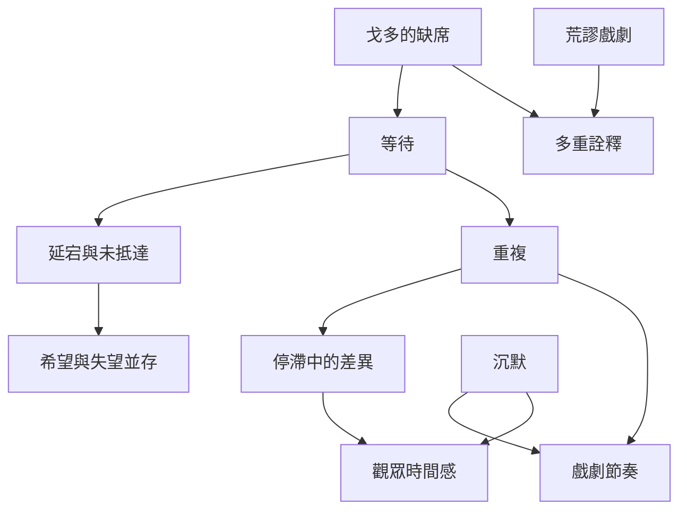

本圖聚焦《等待果陀》如何把等待、重複、沉默與不確定性轉化為可觀看的戲劇形式。人物沒有完成傳統情節任務，劇作卻以節奏、身體、停頓和差異維持觀眾注意。可先讀 [[戈多不必被解碼成單一象徵才能產生意義]]、[[等待讓希望與失望在同一個行動中並存]] 與 [[重複把停滯的時間轉化成可觀看的節奏]]。

概念入口：[[荒謬戲劇]]、[[等待]]、[[重複]]、[[沉默]]、[[時間性]]、[[荒謬]]、[[存在主義]]、[[戲中戲]]。

研究材料：[[荒謬戲劇是評論框架而不是貝克特替自己選定的流派]]、[[時間與沉默研究指出停頓本身也是劇作的符號]]、[[貝克特拒絕替戈多指定單一象徵意義]]。

延伸到 [[MOC｜身體、性別與權力]] 與 [[MOC｜翻譯與跨文化流通]]。
